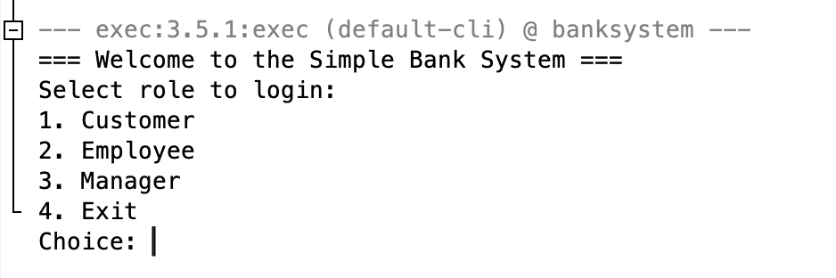
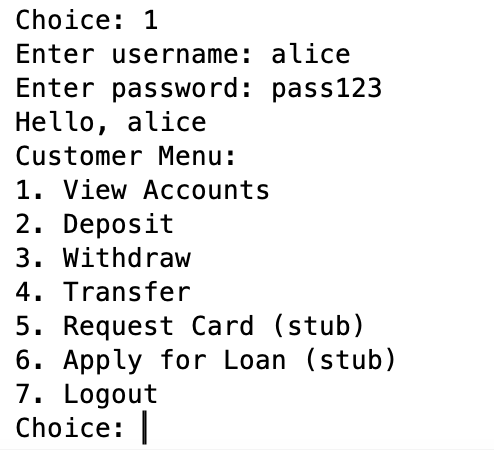
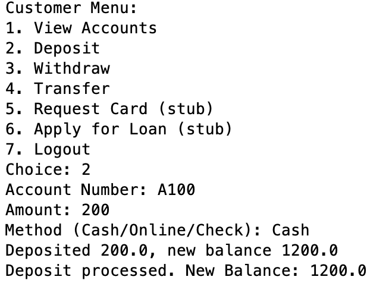
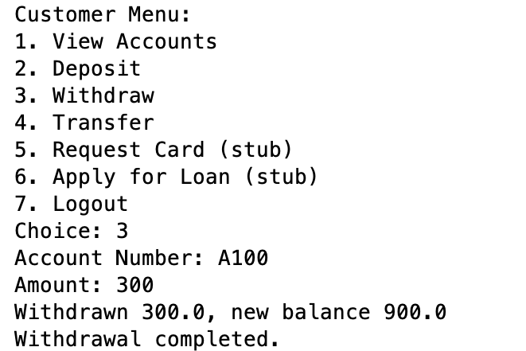
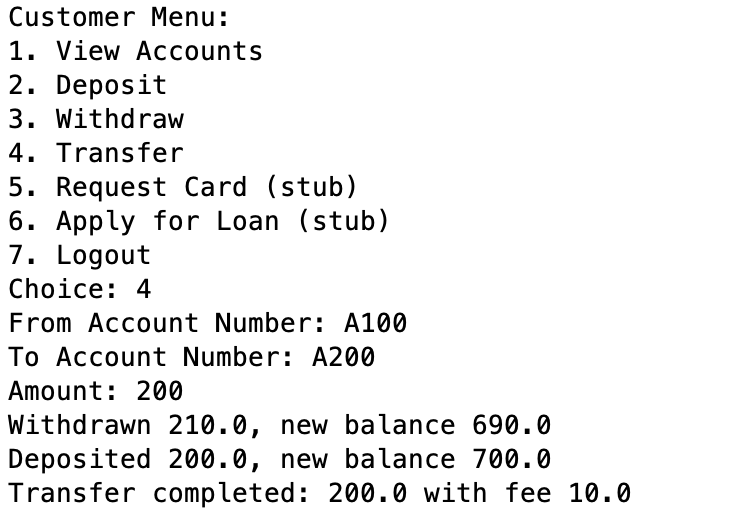
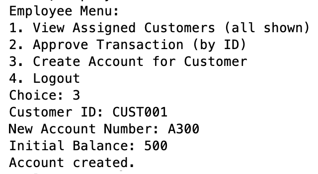
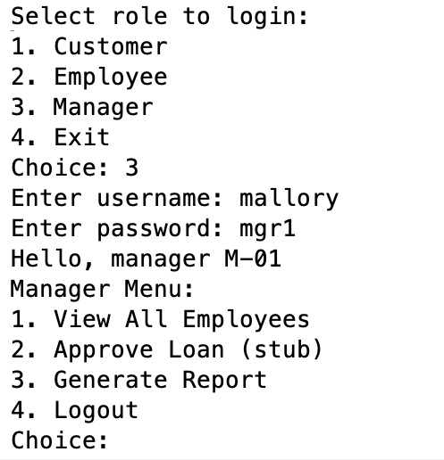
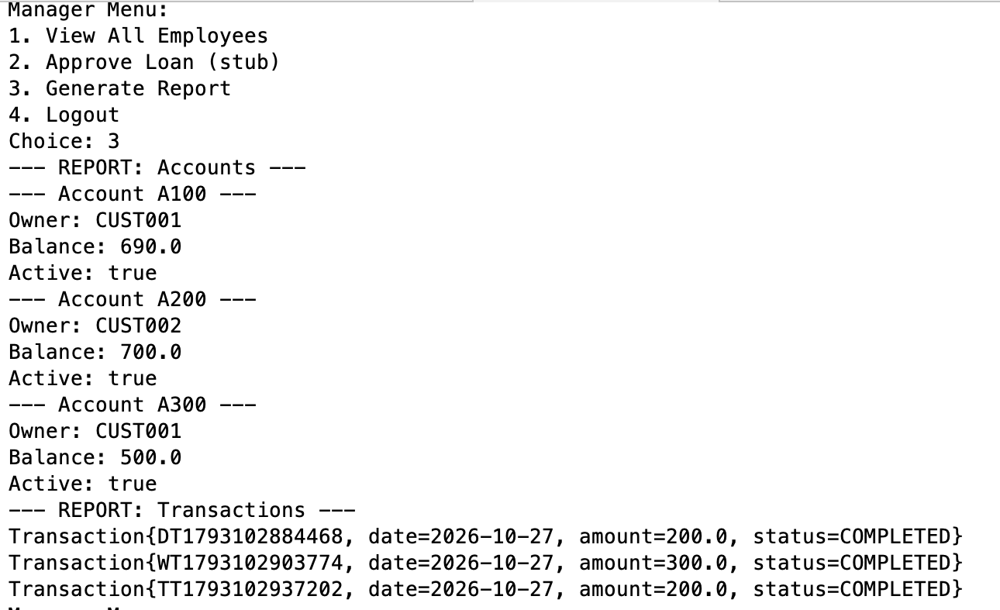

# Bank Management System

A Java command-line banking simulation built as a Maven project in Apache NetBeans. It provides distinct customer, employee, and manager menus and uses seeded **demo data** for exploring core banking operations.

## Features

**Customer**
- Sign in with a demo customer account and view owned accounts.
- Make deposits and withdrawals.
- Transfer between accounts with a 5% transfer fee.
- Card requests and loan applications are placeholders (stubs), not full implementations.

**Employee**
- View the demo customer list.
- Create an account for a customer.
- Access transaction approval by ID (only transactions in `PENDING` state can be approved).

**Manager**
- View employee information.
- Generate an account and transaction report.
- Loan approval is a placeholder (stub).

## Tech stack

- Java
- Apache Maven
- Apache NetBeans
- Command-line interface (CLI)

## Run locally

1. Open the project folder in Apache NetBeans as a Maven project.
2. Run the `com.mycompany.banksystem.Main` class (also configured in `pom.xml` and `nbactions.xml`).
3. Use one of the demo credentials below to explore the menus.

From a terminal with Java and Maven installed, you can also run:

```bash
mvn compile exec:java -Dexec.mainClass=com.mycompany.banksystem.Main
```

> The source project targets Java 26 in `pom.xml`. Use a compatible JDK or adjust the compiler release to the JDK installed locally.

## Demo credentials

| Role | Username | Password |
| --- | --- | --- |
| Customer | `alice` | `pass123` |
| Customer | `bob` | `pass456` |
| Employee | `eve` | `emp1` |
| Manager | `mallory` | `mgr1` |

These accounts are **fictional test data only**. 

## Screenshots

### Main menu


### Customer menu


### Deposit


### Withdrawal


### Transfer with fee


### Employee account creation


### Manager menu


### Manager report and transaction history


## Notes and limitations

- This is a learning/demo application, not a real banking service.
- Data is held in memory and is reinitialized on each application run; no database persistence is implemented.
- Some advertised menu actions are stubs.
- The screenshots show illustrative test sessions. Transaction IDs, dates, and balances can vary after a fresh run.
- Financial calculations use `double`; production banking systems need safer monetary types and additional controls.

## Project Team

This is a collaborative academic project developed by:

1. Reema Fayez Al-mutairi
2. Fatimah Fadil Aldubibi
3. Joory Hussain Alqahtani
4. Shoug Bandar AlMaymuni
5. Lamees Mohammed Aljaroof

## Portfolio Note

This repository demonstrates Java object-oriented programming, class inheritance, role-based CLI menus, in-memory account management, transaction processing, and reporting. It is intended for educational purposes only.
